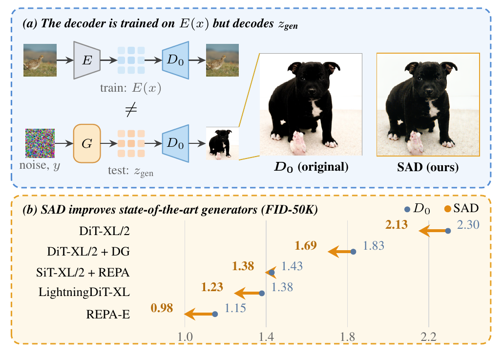
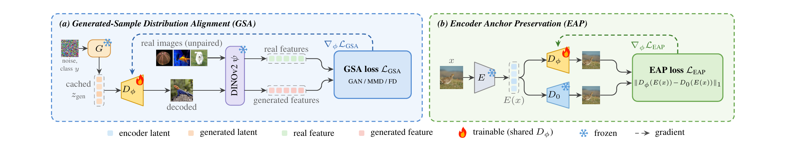
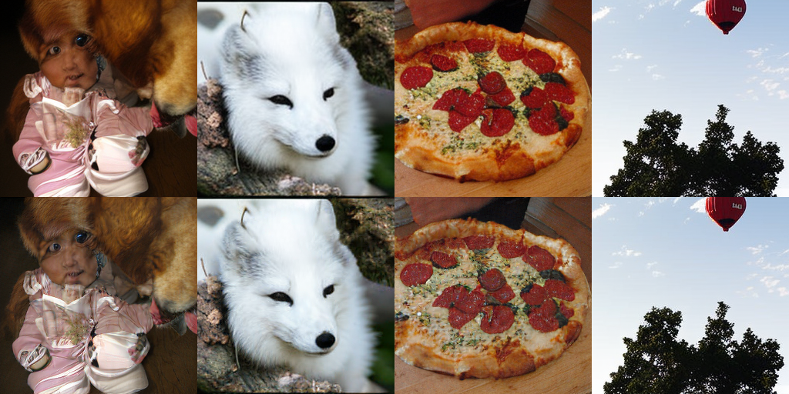

<div align="center">

# Sample-Aligned Decoders for Latent Generative Models

<a href="https://torpedo2003.github.io/SAD/"></a>
<a href="#"></a>
<a href="https://huggingface.co/torpedo2003/SAD"></a>
<a href="LICENSE"></a>

**Your decoder has never seen the latents it decodes. SAD fixes that, with one GPU-hour and zero inference cost.**



</div>

## TL;DR

Every latent generative model ends with a decoder, and that decoder was trained **only on encoder latents** `E(x)`.
At sampling time it decodes **generated latents** `z_gen`, which it has never seen.
The generator's small residual errors therefore go straight into the final image.

**SAD** fine-tunes only the decoder, on the generator's own samples, and leaves everything else untouched:

| | before | after SAD |
|---|---|---|
| REPA-E (FID-50K) | 1.15 | **0.98** |
| LightningDiT-XL (FID-50K) | 1.38 | **1.23** |
| DiT-XL/2 (FID-50K) | 2.30 | **2.13** |
| DiT-XL/2 + discriminator guidance (FID-50K) | 1.83 | **1.69** |
| PixArt-α, text-to-image (FID, COCO) | 34.7 | **23.6** |
| inference cost | 1× | **1×** (same network, new weights) |
| training cost | – | **~1 GPU-hour**, generator frozen |

## The idea in three lines

```
training :  x ──E──▶ E(x) ──D──▶ x̂          the decoder only ever sees encoder latents
sampling :  noise ──G──▶ z_gen ──D──▶ image   ...but this is what it decodes in practice
SAD      :  fine-tune D on z_gen, so the last network in the pipeline is aligned with the samples it actually gets
```

Generators are trained for hundreds of GPU-days to match the latent distribution, and they never match it exactly.
Rather than squeezing out more from the generator, SAD asks a simpler question: **why not let the decoder absorb the remaining error?**
The decoder is small (about 7% of DiT-XL/2), runs once per sample, and no gradient ever needs to flow through the generator.

## Why this is not trivial

Fine-tuning a decoder on generated latents runs into two problems. SAD has one module for each.

1. **There is no target image for a generated latent.**
   → *Generated-Sample Distribution Alignment (GSA)* matches the **distribution** of decoded samples to **unpaired** real images
   in a frozen DINOv2 feature space (GAN, MMD or Fréchet discrepancy). No pairs needed.
2. **Without pairs, the decoder drifts away from the latent space** and forgets how to reconstruct.
   → *Encoder Anchor Preservation (EAP)* keeps the decoder close to the original one on encoder latents with a simple L1 anchor.

<div align="center"></div>

### The "aha" part: where you align matters

The obvious alternative is to fine-tune the decoder with the same distribution loss on **encoder** latents, where pairs exist.
It does not work: FID stays the same or gets worse, and reconstruction breaks (rFID 2.63 → 7.70).
Our analysis explains why (Prop. 1–2 in the paper):

- On encoder latents, the alignment is a **zero-sum game** against the anchor: any decoder that keeps the anchor has the same
  alignment loss as the original one. There is nothing to gain.
- On generated latents, the optimal correction is **weighted by the density ratio** `r(z) = q(z) / p_E(z)` between generated
  and encoder latents. The decoder changes exactly where the generator puts mass that the encoder does not, which is where the
  errors are.

In other words, SAD is a discriminator-driven refinement of every sample, like discriminator guidance,
but **learned once in the decoder weights** instead of paid for at every sampling step. That is also why the two combine
(1.83 → 1.69 FID-50K).

## Quick start

```bash
git clone https://github.com/torpedo2003/SAD && cd SAD
pip install -r requirements.txt
python demo.py                      # writes assets/demo.png: top row D_0, bottom row SAD, same latents
```

Use a SAD decoder in your own pipeline. Only the decoder weights change:

```python
from diffusers import DiTPipeline
from sad import load_sad_decoder

pipe = DiTPipeline.from_pretrained("facebook/DiT-XL-2-256").to("cuda")
load_sad_decoder(pipe.vae, "dit-xl2-256/sad-gan")   # downloads from Hugging Face and swaps the decoder in place
images = pipe(class_labels=[279, 388], num_inference_steps=250, guidance_scale=1.5).images
```

<div align="center"><br><sub>Same DiT-XL/2 latents. Top: original decoder. Bottom: SAD.</sub></div>

## Model zoo

All decoders are on [Hugging Face](https://huggingface.co/torpedo2003/SAD). Each one is trained on latents of its own
generator and sampler; use the one that matches your pipeline.

| Name (`load_sad_decoder`) | Generator | Tokenizer | Sampler | FID-50K (D₀ → SAD) |
|---|---|---|---|---|
| `dit-xl2-256/sad-gan` | DiT-XL/2 | SD-VAE | official 250-step DDPM, cfg 1.5 | 2.30 → **2.13** |
| `dit-xl2-256/sad-mmd` | DiT-XL/2 | SD-VAE | official 250-step DDPM, cfg 1.5 | 2.30 → 2.17 |
| `dit-xl2-256-dpm50/sad-gan` | DiT-XL/2 | SD-VAE | 50-step DPM-Solver++, cfg 1.5 | used in our ablations |
| `dit-xl2-256-dpm50/sad-mmd` | DiT-XL/2 | SD-VAE | 50-step DPM-Solver++, cfg 1.5 | used in our ablations |
| `sit-xl2-repa-256/sad-gan` | SiT-XL/2 + REPA | SD-VAE | SDE 250 steps | 1.43 → **1.38** |
| `lightningdit-xl-vavae-256/sad-gan` | LightningDiT-XL | VA-VAE | official recipe | 1.38 → **1.23** |
| `repa-e-e2evae-256/sad-gan` | REPA-E (SiT-XL/1) | E2E-VAE | SDE 250 steps | 1.15 → **0.98** |
| `pixart-alpha-256/sad-gan` | PixArt-α 256px | SD-VAE | as in the paper | COCO FID 34.7 → **23.6** |

The VA-VAE and E2E-VAE decoders load into the autoencoder classes of the
[LightningDiT](https://github.com/hustvl/LightningDiT) and [REPA-E](https://github.com/End2End-Diffusion/REPA-E) code bases
with the same `load_sad_decoder` call.

## FAQ

**Does SAD change what is generated?** No. The generator, the sampler and the latent are unchanged, so content and layout stay the
same. SAD changes how a latent is rendered: texture, color cast, exposure and local statistics.

**Does it cost anything at inference?** No. The fine-tuned decoder has the same architecture as the original one.

**Can I train SAD for my own generator?** Yes. You need a cache of generated latents (16k–40k), a few thousand unpaired real
images and about one GPU-hour. See [`training/`](training/README.md) and `training/scripts/run_examples.sh`.

**What doesn't it do?** It cannot add diversity or repair a wrong structure that the generator produced, and a decoder is specific
to its generator and sampler family.

## Training and evaluation

[`training/`](training/README.md) contains the full code used in the paper: latent caching for every generator, SAD training
(`train_sad.py`), the baselines (noise-robust decoders, paired post-training, pixel refiner, FDDA re-implementation), and
evaluation (FID-50K with the ADM evaluator, FD<sub>CLIP</sub>, KID, SigLIP FD, CMMD, HPS, PickScore).

```bash
cd training
python train_sad.py --mode gen --loss gan --lam 0.05 --steps 2000 --gen_pool cfg1.5 --out runs/sad_gan
python fid50k.py --ckpt runs/sad_gan/decoder.pt --set dit50k_cfg1.5 --ref_split_b --out results/sad_gan.json
```

## Citation

```bibtex
@article{sad2026,
  title   = {Sample-Aligned Decoders for Latent Generative Models},
  author  = {TBD},
  journal = {arXiv preprint},
  year    = {2026}
}
```

## Acknowledgements

This code builds on [DiT](https://github.com/facebookresearch/DiT), [SiT](https://github.com/willisma/SiT),
[REPA](https://github.com/sihyun-yu/REPA), [REPA-E](https://github.com/End2End-Diffusion/REPA-E),
[LightningDiT](https://github.com/hustvl/LightningDiT), [PixArt-α](https://github.com/PixArt-alpha/PixArt-alpha),
[Discriminator Guidance](https://github.com/alsdudrla10/DG) and [diffusers](https://github.com/huggingface/diffusers).
