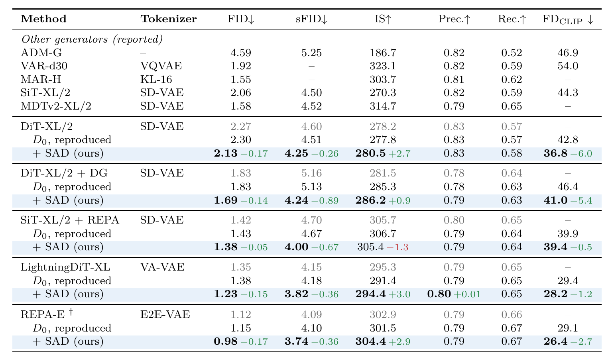
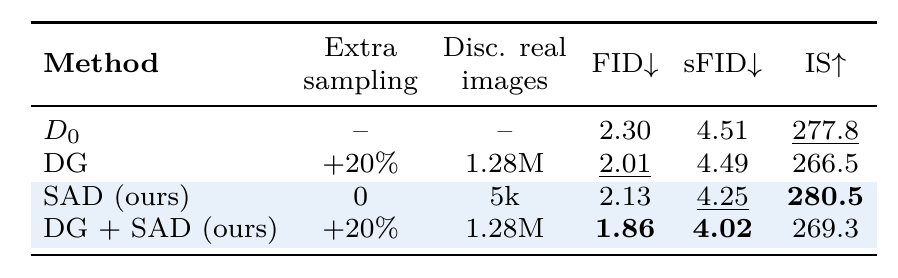
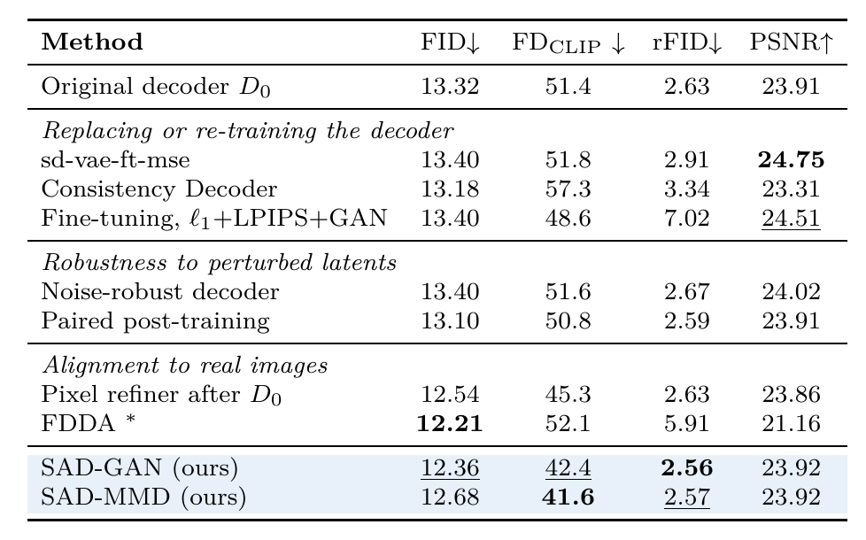
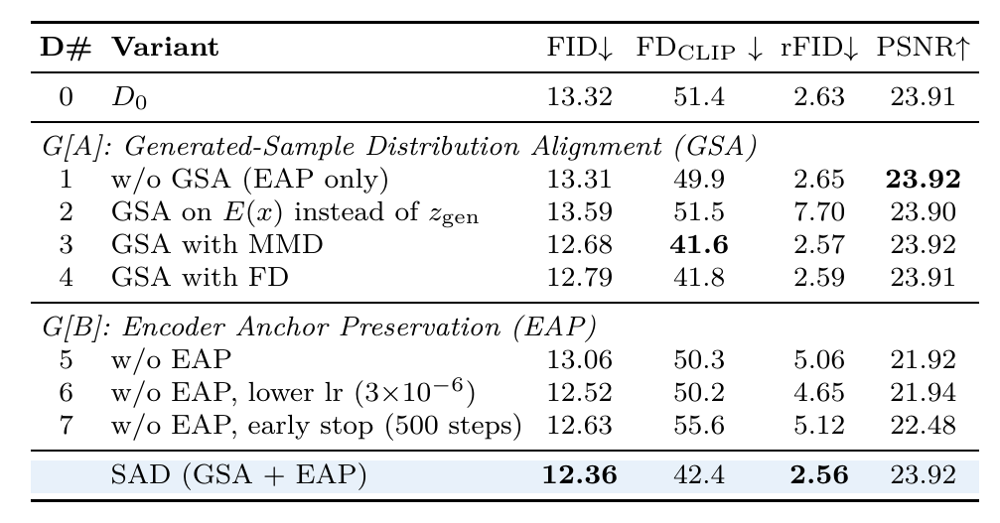
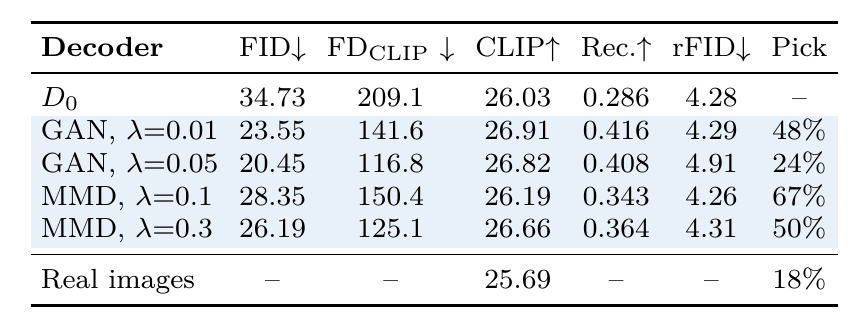

<div align="center">

# Sample-Aligned Decoders for Latent Generative Models

<a href="https://torpedo2003.github.io/SAD/"></a>
<a href="#"></a>
<a href="https://huggingface.co/torpedo2003/SAD"></a>
<a href="LICENSE"></a>

The decoder of a latent generative model never sees generated latents in training.<br>
SAD fine-tunes only the decoder on them in ~1 GPU-hour, keeping the generator frozen.<br>
It improves DiT, SiT, LightningDiT, REPA-E and PixArt-&alpha; at no extra inference cost.


</div>

## Overview

The decoder of a latent generative model is trained on encoder latents but decodes generated latents at test time.
SAD fine-tunes only this decoder in about one GPU-hour, with two losses:

- **Generated-Sample Distribution Alignment (GSA)** aligns decoded generated latents with unpaired real images in a frozen DINOv2 feature space.
- **Encoder Anchor Preservation (EAP)** keeps the decoder close to the original one on encoder latents, so reconstruction is preserved.

<div align="center"></div>

## Results

### ImageNet 256×256 (FID-50K, ADM evaluator)

For each released generator: the reported result (gray), our evaluation with the original decoder D<sub>0</sub>, and SAD on the same latents.

<div align="center"></div>

### Decoder-side vs. generator-side correction

DiT-XL/2, official recipe, guidance 1.5. SAD needs no extra sampling and only 5k real images, and it stacks with discriminator guidance (DG).

<div align="center"></div>

### Comparison with other decoder adaptations

DiT-XL/2, 50-step DPM-Solver++, 10k samples. FD<sub>CLIP</sub> and rFID are not used in training. \*FDDA optimizes Inception features, the network used by FID.

<div align="center"></div>

### Ablation

<div align="center"></div>

### Text-to-image (PixArt-α, COCO, 10k samples)

Pick: share of samples preferred by PickScore over D<sub>0</sub>.

<div align="center"></div>

### Qualitative results

<div align="center"><br><sub>Same DiT-XL/2 latents (50-step DPM-Solver++). Top: original decoder D<sub>0</sub>. Middle: SAD. Bottom: per-pixel difference (brighter is larger). SAD keeps content and layout and corrects color cast, exposure and texture. The latents are in <code>assets/showcase_latents.npz</code>; <code>python reproduce_readme_figure.py</code> regenerates this figure.</sub></div>

## Quick start

```bash
git clone https://github.com/torpedo2003/SAD && cd SAD
pip install -r requirements.txt
python reproduce_readme_figure.py   # decodes the 8 latents below with D_0 and SAD -> assets/comparison_reproduced.jpg
python demo.py                      # samples new DiT-XL/2 latents and decodes them with D_0 and SAD -> assets/demo.png
```

Use a SAD decoder in your own pipeline. Only the decoder weights change:

```python
from diffusers import DiTPipeline
from sad import load_sad_decoder

pipe = DiTPipeline.from_pretrained("facebook/DiT-XL-2-256").to("cuda")
load_sad_decoder(pipe.vae, "dit-xl2-256/sad-gan")   # downloads from Hugging Face and swaps the decoder in place
images = pipe(class_labels=[279, 388], num_inference_steps=250, guidance_scale=1.5).images
```


## Model zoo

All decoders are on [Hugging Face](https://huggingface.co/torpedo2003/SAD). Each one is trained on latents of its own
generator and sampler; use the one that matches your pipeline.

| Name (`load_sad_decoder`) | Generator | Tokenizer | Sampler |
|---|---|---|---|
| `dit-xl2-256/sad-gan` | DiT-XL/2 | SD-VAE | official 250-step DDPM, cfg 1.5 |
| `dit-xl2-256/sad-mmd` | DiT-XL/2 | SD-VAE | official 250-step DDPM, cfg 1.5 |
| `dit-xl2-256-dpm50/sad-gan` | DiT-XL/2 | SD-VAE | 50-step DPM-Solver++, cfg 1.5 |
| `dit-xl2-256-dpm50/sad-mmd` | DiT-XL/2 | SD-VAE | 50-step DPM-Solver++, cfg 1.5 |
| `sit-xl2-repa-256/sad-gan` | SiT-XL/2 + REPA | SD-VAE | SDE 250 steps |
| `lightningdit-xl-vavae-256/sad-gan` | LightningDiT-XL | VA-VAE | official recipe |
| `repa-e-e2evae-256/sad-gan` | REPA-E (SiT-XL/1) | E2E-VAE | SDE 250 steps |
| `pixart-alpha-256/sad-gan` | PixArt-α 256px | SD-VAE | as in the paper |

The VA-VAE and E2E-VAE decoders load into the autoencoder classes of the
[LightningDiT](https://github.com/hustvl/LightningDiT) and [REPA-E](https://github.com/End2End-Diffusion/REPA-E) code bases
with the same `load_sad_decoder` call.

## FAQ

**Does SAD change what is generated?** No. The generator, the sampler and the latent are unchanged, so content and layout stay the
same. SAD changes how a latent is rendered: texture, color cast, exposure and local statistics.

**Does it cost anything at inference?** No. The fine-tuned decoder has the same architecture as the original one.

**Can I train SAD for my own generator?** Yes. You need a cache of generated latents (16k–40k), a few thousand unpaired real
images and about one GPU-hour. See [`training/`](training/README.md) and `training/scripts/run_examples.sh`.

**What doesn't it do?** It cannot add diversity or repair a wrong structure that the generator produced, and a decoder is specific
to its generator and sampler family.

## Training and evaluation

[`training/`](training/README.md) contains the full code of the paper and a step-by-step guide. In short:

```bash
cd training
python prepare_data.py                                                   # ADM reference split + real images
python gen_latents.py --n 5000 --cfg 1.5 --seed 1000 --out data/gen_train/cfg1.5_r0.npz   # cache generated latents (r = 0..7)
python train_sad.py --mode gen --loss gan --lam 0.05 --gen_pool cfg1.5 --out runs/sad_gan   # ~1 GPU-hour
python eval_decoder.py --sets all_cfg1.5 --ckpt runs/sad_gan/decoder.pt --out results/sad_gan.json
```

The guide also covers FID-50K with the official ADM evaluator, the held-out metrics, every generator in the paper
(DiT, SiT + REPA, LightningDiT, REPA-E, PixArt-α, discriminator guidance), and the baselines and ablations.

## Citation

```bibtex
@article{lei2026sad,
  title   = {Sample-Aligned Decoders for Latent Generative Models},
  author  = {Lei, Yu and Li, Yi and Gao, Hongcheng and Wei, Yipeng and Li, Liang and Su, Li and Huang, Qingming},
  journal = {arXiv preprint},
  year    = {2026}
}
```

## Acknowledgements

This code builds on [DiT](https://github.com/facebookresearch/DiT), [SiT](https://github.com/willisma/SiT),
[REPA](https://github.com/sihyun-yu/REPA), [REPA-E](https://github.com/End2End-Diffusion/REPA-E),
[LightningDiT](https://github.com/hustvl/LightningDiT), [PixArt-α](https://github.com/PixArt-alpha/PixArt-alpha),
[Discriminator Guidance](https://github.com/alsdudrla10/DG) and [diffusers](https://github.com/huggingface/diffusers).
