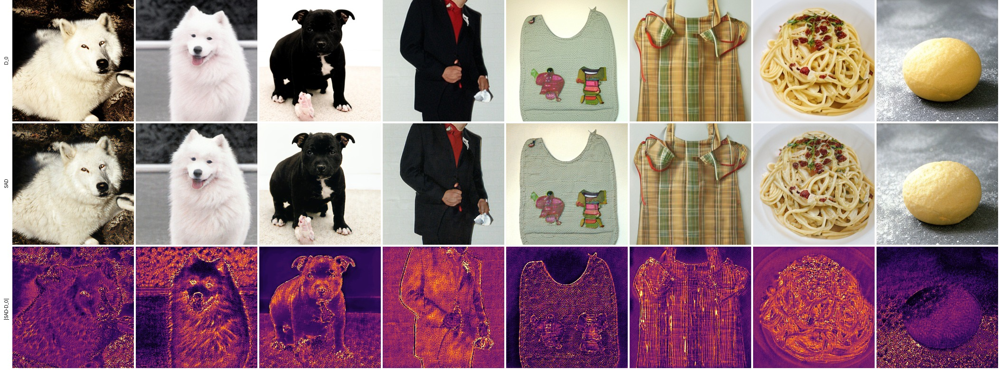

<div align="center">

# Sample-Aligned Decoders for Latent Generative Models

<a href="https://torpedo2003.github.io/SAD/"></a>
<a href="#"></a>
<a href="https://huggingface.co/torpedo2003/SAD"></a>
<a href="LICENSE"></a>

The decoder of a latent generative model is trained on encoder latents, but at test time it decodes the generator's latents.<br>
SAD fine-tunes only the decoder on these generated latents, in about one GPU-hour with the generator frozen,<br>
and improves DiT, SiT + REPA, LightningDiT, REPA-E and PixArt-&alpha; with the same sampling pipeline and no extra inference cost.


</div>

## Overview

The decoder of a latent generative model is trained on encoder latents but decodes generated latents at test time.
SAD fine-tunes only this decoder in about one GPU-hour, with two losses:

- **Generated-Sample Distribution Alignment (GSA)** aligns decoded generated latents with unpaired real images in a frozen DINOv2 feature space.
- **Encoder Anchor Preservation (EAP)** keeps the decoder close to the original one on encoder latents, so reconstruction is preserved.

<div align="center"></div>

## Results

### ImageNet 256×256 (FID-50K, ADM evaluator)

The same generated latents are decoded by the original decoder D<sub>0</sub> (reproduced) and by SAD.

| Generator | Tokenizer | FID ↓ | sFID ↓ | IS ↑ | Prec. ↑ | Rec. ↑ | FD<sub>CLIP</sub> ↓ |
|---|---|---|---|---|---|---|---|
| DiT-XL/2 | SD-VAE | 2.30 → **2.13** | 4.51 → **4.25** | 277.8 → **280.5** | 0.83 → 0.83 | 0.57 → 0.58 | 42.8 → **36.8** |
| DiT-XL/2 + DG | SD-VAE | 1.83 → **1.69** | 5.13 → **4.24** | 285.3 → **286.2** | 0.78 → 0.79 | 0.63 → 0.63 | 46.4 → **41.0** |
| SiT-XL/2 + REPA | SD-VAE | 1.43 → **1.38** | 4.67 → **4.00** | 306.7 → 305.4 | 0.79 → 0.79 | 0.64 → 0.64 | 39.9 → **39.4** |
| LightningDiT-XL | VA-VAE | 1.38 → **1.23** | 4.18 → **3.82** | 291.4 → **294.4** | 0.79 → **0.80** | 0.65 → 0.65 | 29.4 → **28.2** |
| REPA-E | E2E-VAE | 1.15 → **0.98** | 4.10 → **3.74** | 301.5 → **304.4** | 0.79 → 0.79 | 0.67 → 0.67 | 29.1 → **26.4** |

### Decoder-side vs. generator-side correction

DiT-XL/2, official recipe, guidance 1.5. SAD needs no extra sampling and 5k real images, and it stacks with discriminator guidance (DG).

| Method | Extra sampling | Real images | FID ↓ | sFID ↓ | IS ↑ |
|---|---|---|---|---|---|
| D<sub>0</sub> | – | – | 2.30 | 4.51 | 277.8 |
| DG | +20% | 1.28M | 2.01 | 4.49 | 266.5 |
| **SAD** | **0** | **5k** | 2.13 | 4.25 | **280.5** |
| **DG + SAD** | +20% | 1.28M | **1.86** | **4.02** | 269.3 |

### Comparison with other decoder adaptations

DiT-XL/2, 50-step DPM-Solver++, 10k samples; FD<sub>CLIP</sub> and rFID are not used in training.

| Method | FID ↓ | FD<sub>CLIP</sub> ↓ | rFID ↓ | PSNR ↑ |
|---|---|---|---|---|
| Original decoder D<sub>0</sub> | 13.32 | 51.4 | 2.63 | 23.91 |
| sd-vae-ft-mse | 13.40 | 51.8 | 2.91 | 24.75 |
| Consistency Decoder | 13.18 | 57.3 | 3.34 | 23.31 |
| Fine-tuning on encoder latents (ℓ1 + LPIPS + GAN) | 13.40 | 48.6 | 7.02 | 24.51 |
| Noise-robust decoder | 13.40 | 51.6 | 2.67 | 24.02 |
| Paired post-training | 13.10 | 50.8 | 2.59 | 23.91 |
| Pixel refiner after D<sub>0</sub> | 12.54 | 45.3 | 2.63 | 23.86 |
| FDDA (Inception in the objective) | **12.21** | 52.1 | 5.91 | 21.16 |
| **SAD-GAN** | 12.36 | 42.4 | **2.56** | 23.92 |
| **SAD-MMD** | 12.68 | **41.6** | 2.57 | 23.92 |

### Ablation

| Variant | FID ↓ | FD<sub>CLIP</sub> ↓ | rFID ↓ |
|---|---|---|---|
| D<sub>0</sub> | 13.32 | 51.4 | 2.63 |
| w/o GSA (anchor only) | 13.31 | 49.9 | 2.65 |
| GSA on encoder latents E(x) instead of generated latents | 13.59 | 51.5 | 7.70 |
| w/o EAP | 13.06 | 50.3 | 5.06 |
| **SAD (GSA + EAP)** | **12.36** | **42.4** | **2.56** |

### Text-to-image (PixArt-α, COCO, 10k samples)

| Decoder | FID ↓ | FD<sub>CLIP</sub> ↓ | CLIP score ↑ | Recall ↑ | rFID ↓ |
|---|---|---|---|---|---|
| D<sub>0</sub> | 34.73 | 209.1 | 26.03 | 0.286 | 4.28 |
| **SAD** (GAN, λ = 0.01) | **23.55** | **141.6** | **26.91** | **0.416** | 4.29 |

### Qualitative results

<div align="center"><br><sub>Same DiT-XL/2 latents (50-step DPM-Solver++). Top: original decoder D<sub>0</sub>. Middle: SAD. Bottom: per-pixel difference (brighter is larger). SAD keeps content and layout and corrects color cast, exposure and texture. The latents are in <code>assets/showcase_latents.npz</code>; <code>python reproduce_readme_figure.py</code> regenerates this figure.</sub></div>

## Quick start

```bash
git clone https://github.com/torpedo2003/SAD && cd SAD
pip install -r requirements.txt
python reproduce_readme_figure.py   # decodes the 8 latents below with D_0 and SAD -> assets/comparison_reproduced.jpg
python demo.py                      # samples new DiT-XL/2 latents and decodes them with D_0 and SAD -> assets/demo.png
```

Use a SAD decoder in your own pipeline. Only the decoder weights change:

```python
from diffusers import DiTPipeline
from sad import load_sad_decoder

pipe = DiTPipeline.from_pretrained("facebook/DiT-XL-2-256").to("cuda")
load_sad_decoder(pipe.vae, "dit-xl2-256/sad-gan")   # downloads from Hugging Face and swaps the decoder in place
images = pipe(class_labels=[279, 388], num_inference_steps=250, guidance_scale=1.5).images
```


## Model zoo

All decoders are on [Hugging Face](https://huggingface.co/torpedo2003/SAD). Each one is trained on latents of its own
generator and sampler; use the one that matches your pipeline.

| Name (`load_sad_decoder`) | Generator | Tokenizer | Sampler | FID-50K (D₀ → SAD) |
|---|---|---|---|---|
| `dit-xl2-256/sad-gan` | DiT-XL/2 | SD-VAE | official 250-step DDPM, cfg 1.5 | 2.30 → **2.13** |
| `dit-xl2-256/sad-mmd` | DiT-XL/2 | SD-VAE | official 250-step DDPM, cfg 1.5 | 2.30 → 2.17 |
| `dit-xl2-256-dpm50/sad-gan` | DiT-XL/2 | SD-VAE | 50-step DPM-Solver++, cfg 1.5 | used in our ablations |
| `dit-xl2-256-dpm50/sad-mmd` | DiT-XL/2 | SD-VAE | 50-step DPM-Solver++, cfg 1.5 | used in our ablations |
| `sit-xl2-repa-256/sad-gan` | SiT-XL/2 + REPA | SD-VAE | SDE 250 steps | 1.43 → **1.38** |
| `lightningdit-xl-vavae-256/sad-gan` | LightningDiT-XL | VA-VAE | official recipe | 1.38 → **1.23** |
| `repa-e-e2evae-256/sad-gan` | REPA-E (SiT-XL/1) | E2E-VAE | SDE 250 steps | 1.15 → **0.98** |
| `pixart-alpha-256/sad-gan` | PixArt-α 256px | SD-VAE | as in the paper | COCO FID 34.7 → **23.6** |

The VA-VAE and E2E-VAE decoders load into the autoencoder classes of the
[LightningDiT](https://github.com/hustvl/LightningDiT) and [REPA-E](https://github.com/End2End-Diffusion/REPA-E) code bases
with the same `load_sad_decoder` call.

## FAQ

**Does SAD change what is generated?** No. The generator, the sampler and the latent are unchanged, so content and layout stay the
same. SAD changes how a latent is rendered: texture, color cast, exposure and local statistics.

**Does it cost anything at inference?** No. The fine-tuned decoder has the same architecture as the original one.

**Can I train SAD for my own generator?** Yes. You need a cache of generated latents (16k–40k), a few thousand unpaired real
images and about one GPU-hour. See [`training/`](training/README.md) and `training/scripts/run_examples.sh`.

**What doesn't it do?** It cannot add diversity or repair a wrong structure that the generator produced, and a decoder is specific
to its generator and sampler family.

## Training and evaluation

[`training/`](training/README.md) contains the full code used in the paper: latent caching for every generator, SAD training
(`train_sad.py`), the baselines (noise-robust decoders, paired post-training, pixel refiner, FDDA re-implementation), and
evaluation (FID-50K with the ADM evaluator, FD<sub>CLIP</sub>, KID, SigLIP FD, CMMD, HPS, PickScore).

```bash
cd training
python train_sad.py --mode gen --loss gan --lam 0.05 --steps 2000 --gen_pool cfg1.5 --out runs/sad_gan
python fid50k.py --ckpt runs/sad_gan/decoder.pt --set dit50k_cfg1.5 --ref_split_b --out results/sad_gan.json
```

## Citation

```bibtex
@article{lei2026sad,
  title   = {Sample-Aligned Decoders for Latent Generative Models},
  author  = {Lei, Yu and Li, Yi and Gao, Hongcheng and Wei, Yipeng and Li, Liang and Su, Li and Huang, Qingming},
  journal = {arXiv preprint},
  year    = {2026}
}
```

## Acknowledgements

This code builds on [DiT](https://github.com/facebookresearch/DiT), [SiT](https://github.com/willisma/SiT),
[REPA](https://github.com/sihyun-yu/REPA), [REPA-E](https://github.com/End2End-Diffusion/REPA-E),
[LightningDiT](https://github.com/hustvl/LightningDiT), [PixArt-α](https://github.com/PixArt-alpha/PixArt-alpha),
[Discriminator Guidance](https://github.com/alsdudrla10/DG) and [diffusers](https://github.com/huggingface/diffusers).
